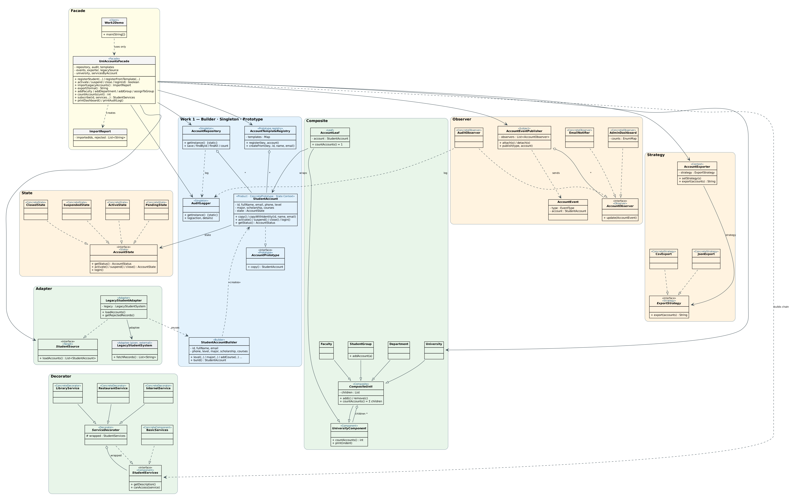
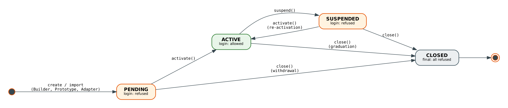

# UniAccounts — University Student Account Management System

Java practical work on **Design Patterns**, in two consecutive works:

- **Work 1** (tag `work1`): the core with the creational patterns: Builder, Singleton, Prototype.
- **Work 2** (tag `work2`): the complete system: State, Observer, Strategy, Composite, Adapter, Decorator, Facade.

Work 2 is built **on top of** Work 1: the Builder, the Singletons and the Prototype are reused, not rewritten (see [what changed](#what-changed-in-work-1)).

## Quick start

Requires **JDK 8 or newer**, nothing else (no Maven, no external library).

| | Linux / macOS / Git Bash | Windows |
|---|---|---|
| Work 2 demo (complete system, through the Facade) | `./run.sh` | `run.bat` |
| Work 1 demo (Builder, Singleton, Prototype) | `./run.sh work1` | `run.bat work1` |
| All automated tests (140 checks) | `./run.sh test` | `run.bat test` |

Without the scripts:

```sh
mkdir out
javac -encoding UTF-8 -d out $(find src test -name "*.java")
java -cp out dz.univ.uniaccounts.app.Work2Demo      # or app.Work1Demo, or AllTests
```

More details (IDE, Windows without scripts): [docs/HOW_TO_RUN.md](docs/HOW_TO_RUN.md).

## The ten patterns

| Pattern | Classes (role) | Problem from the assignment |
|---|---|---|
| Builder | `StudentAccountBuilder` (Builder), `StudentAccount` (Product) | 8 fields, 5 optional; validation in `build()` |
| Singleton | `AccountRepository`, `AuditLogger` | one repository, one audit log |
| Prototype | `AccountPrototype`, `StudentAccount` (ConcretePrototype), `AccountTemplateRegistry` | a template per batch, then copies (deep copy of the courses) |
| State | `AccountState`, `PendingState`, `ActiveState`, `SuspendedState`, `ClosedState`; `StudentAccount` (Context) | behaviour depends on the status; no login when suspended |
| Observer | `AccountEventPublisher` (Subject), `AccountObserver`, `AuditObserver`, `EmailNotifier`, `AdminDashboard` | 5 events must reach 3 observers |
| Strategy | `ExportStrategy`, `CsvExport`, `JsonExport`, `AccountExporter` (Context) | export in several formats |
| Composite | `UniversityComponent`, `CompositeUnit`, `University`, `Faculty`, `Department`, `StudentGroup`, `AccountLeaf` | "how many accounts?" asked to any node of the tree |
| Adapter | `StudentSource` (Target), `LegacyStudentAdapter` (Adapter), `LegacyStudentSystem` (Adaptee) | old system with an incompatible interface that must not be modified |
| Decorator | `StudentServices`, `BasicServices`, `ServiceDecorator`, `LibraryService`, `RestaurantService`, `InternetService` | services in any combination |
| Facade | `UniAccountsFacade` (Facade), `Work2Demo` (Client) | a simple interface that hides the system |

Every class participating in a pattern starts with a comment `Pattern: X — Role: Y`.

## Class diagram



Full-size vector version: [docs/uml/work2-class-diagram.svg](docs/uml/work2-class-diagram.svg) · Work 1 only: [docs/uml/work1-class-diagram.png](docs/uml/work1-class-diagram.png)

## Account life cycle (State)



Login is allowed only in `ACTIVE`. A refused transition throws `IllegalStateException`; the Facade logs it as `REFUSED` and does **not** notify the observers.

## Project layout

```
src/dz/univ/uniaccounts/
├── app/         Work1Demo, Work2Demo                         demos (clients)
├── model/       StudentAccount, StudentAccountBuilder,
│                AccountPrototype, AccountRules                Builder, Prototype, State context
├── repository/  AccountRepository, DuplicateAccountException  Singleton
├── audit/       AuditLogger                                   Singleton
├── template/    AccountTemplateRegistry                       Prototype
├── state/       AccountState, AccountStatus + 4 states        State
├── observer/    AccountEventPublisher, AccountObserver, AccountEvent, EventType,
│                AuditObserver, EmailNotifier, AdminDashboard  Observer
├── export/      ExportStrategy, CsvExport, JsonExport, AccountExporter   Strategy
├── structure/   UniversityComponent, CompositeUnit, University, Faculty,
│                Department, StudentGroup, AccountLeaf         Composite
├── legacy/      LegacyStudentSystem                           given class (Adaptee)
├── adapter/     StudentSource, LegacyStudentAdapter           Adapter
├── services/    StudentServices, BasicServices, ServiceDecorator,
│                LibraryService, RestaurantService, InternetService   Decorator
└── facade/      UniAccountsFacade, ImportReport               Facade
test/dz/univ/uniaccounts/   Check, Work1Tests, Work2Tests, AllTests
docs/
├── HOW_TO_RUN.md, REQUIREMENTS.md, EXPLAINED_AR.md
├── uml/              class diagrams (.dot source, .png, .svg) and state diagram
├── screenshots/      images of the real program output
├── reports/          Rapport_Work1.pdf, Rapport_Work2.pdf
└── legacy-original/  LegacyStudentSystem.java exactly as given (does not compile)
```

## The legacy system

The `LegacyStudentSystem` class given in the assignment **does not compile** (`");` instead of `",` after records 2, 4, 6, 8) and has **no package**, so it cannot be imported from our packages. The original is kept untouched in [docs/legacy-original/](docs/legacy-original/); the compiled copy only adds the `package` line and fixes the 4 commas. Its data is unchanged, including the **duplicate id `19990008`**: the import gives **9 imported, 1 rejected** (the repository refuses the second `19990008`).

## What changed in Work 1

`git diff work1 work2 -- src` shows that Work 1 was extended, not rewritten:

| File | Change | Reason |
|---|---|---|
| `StudentAccount` | + field `state` (starts `PendingState`), `activate/suspend/close/login/getStatus`, `status` in `toString` | it is the State context; the CSV export needs the status. Copies from a template also start `PENDING` (field initializer) |
| `DuplicateAccountException` | + `serialVersionUID` | compiler warning only |
| `run.sh`, `run.bat` | default demo = Work 2, option `work1`, tests of both works | run both works |

The Builder, the Singletons, the template registry, `AccountRules`, `Work1Demo` and `Work1Tests` are unchanged, and Work 1's 49 tests still pass inside `AllTests`.

## Reports and documentation

- [docs/reports/Rapport_Work1.pdf](docs/reports/Rapport_Work1.pdf) — Work 1 report (5 pages)
- [docs/reports/Rapport_Work2.pdf](docs/reports/Rapport_Work2.pdf) — Work 2 report (7 pages)
- [docs/EXPLAINED_AR.md](docs/EXPLAINED_AR.md) — شرح المشروع بالعربية للمناقشة، مع الأسئلة المتوقعة
- [docs/REQUIREMENTS.md](docs/REQUIREMENTS.md) — requirements analysis, plan and checklist

## Sources

Gamma, Helm, Johnson, Vlissides, *Design Patterns* (1994) · Bloch, *Effective Java*, 3rd ed. (2018) · Freeman & Robson, *Head First Design Patterns*, 2nd ed. (2020) · [refactoring.guru/design-patterns](https://refactoring.guru/design-patterns) · course material.
