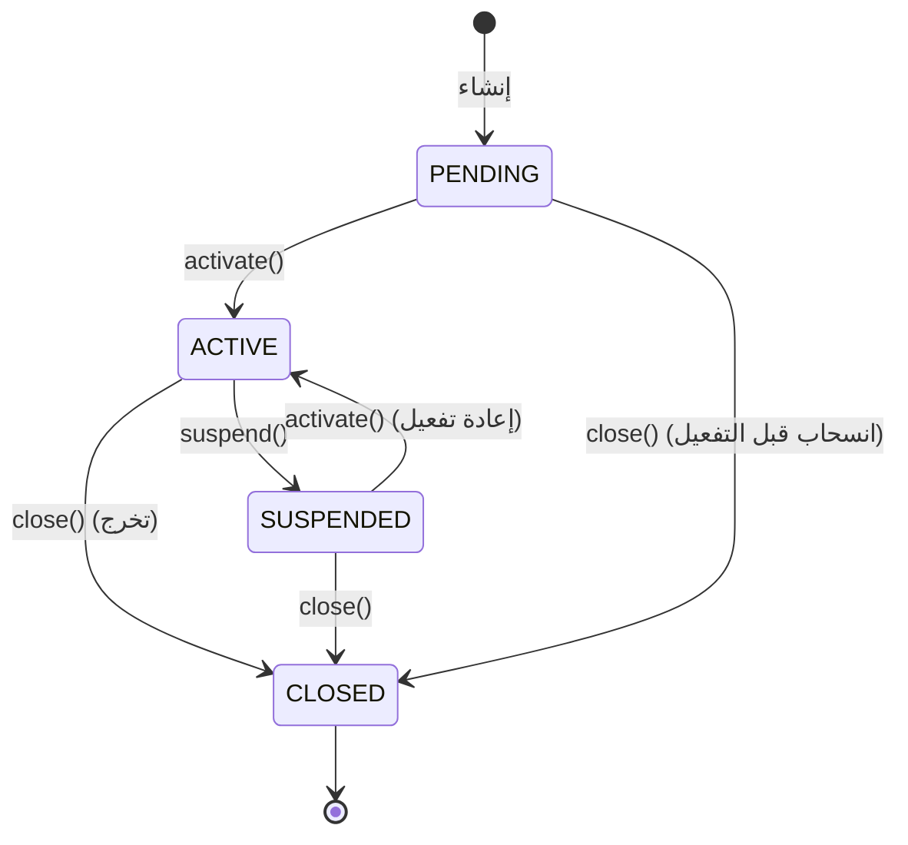
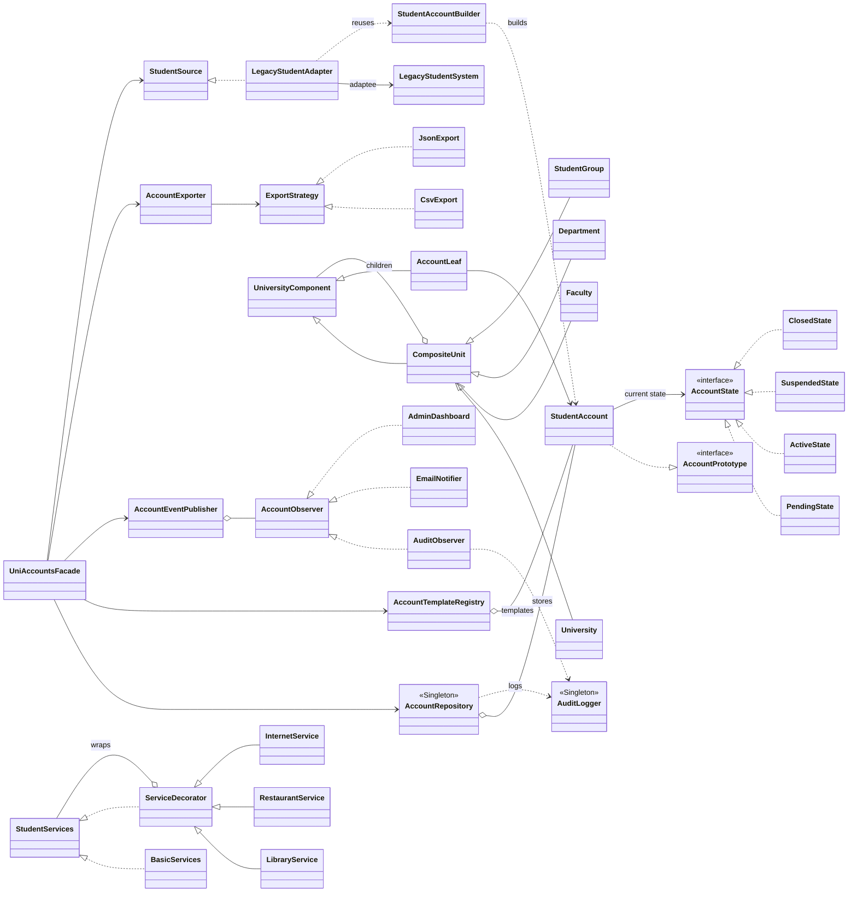

# UniAccounts — تحليل المتطلبات وخطة التنفيذ

> نظام إدارة حسابات الطلبة — عمل تطبيقي في نماذج التصميم (Design Patterns) بلغة Java
> هذا الملف مرجع العمل: ما يطلبه الأستاذ، وقرارات التصميم، وخطة التنفيذ، وقائمة التحقق.

## اصطلاحات هذا الملف

| الوسم | المعنى |
|---|---|
| **[إلزامي]** | منصوص عليه في ملف التكليف، ولا يجوز إهماله |
| **[قرار تصميم]** | التكليف لا يحدده، فنختار نحن طريقة تنفيذه ونستطيع الدفاع عنها |
| **[اقتراح]** | تحسين إضافي غير مطلوب. يمكن حذفه دون أن يؤثر على العلامة |
| **[يحتاج حسماً]** | نقطة غامضة أو متناقضة في التكليف، تحتاج قراراً منك أو سؤال الأستاذ |

---

## 1. فهم المشروع

الجامعة تريد نظاماً صغيراً لإدارة حسابات الطلبة. عند التحاق طالب يُنشأ له حساب، ويمر الحساب بدورة حياة: ينتظر التفعيل، ثم يُفعَّل، وقد يُعلَّق، ويُغلق عند التخرج. تُحفظ الحسابات في **مستودع مركزي**، وتُسجَّل العمليات في **سجل تدقيق (Audit Log)**.

**الهدف التعليمي [إلزامي]:** أن يُستعمل كل نمط في الموضع الذي يحل فيه مشكلة حقيقية، وأن تفهم لماذا اخترته. لهذا تقوم خطتنا كلها على أن يكون لكل نمط **مشكلة محددة** في النظام، ولا يُضاف نمط للزينة.

**المرحلتان [إلزامي]:** المرحلة الثانية تُبنى فوق الأولى ولا تبدأ من الصفر.

| | العمل الأول | العمل الثاني |
|---|---|---|
| نوع الأنماط | إنشائية (Creational) | بنائية (Structural) وسلوكية (Behavioral) |
| الأنماط | Builder, Singleton, Prototype | State, Observer, Strategy, Composite, Adapter, Decorator, Facade |
| السؤال | كيف **ننشئ** الحسابات والمستودع بشكل سليم؟ | كيف **ننظّم** النظام ونوسّعه ونجعل أجزاءه تتفاعل؟ |
| النتيجة | نواة: إنشاء الحسابات وتخزينها وتسجيلها | نظام كامل: دورة حياة، إشعارات، تصدير، هيكل جامعي، استيراد من نظام قديم |

---

## 2. التعليمات العامة [إلزامي]

| # | التعليمة | كيف نلتزم بها |
|---|---|---|
| G1 | تنظيم الأصناف في **حزم (packages) واضحة** | حزمة لكل مسؤولية (انظر §6) |
| G2 | **الأصناف في ملفات منفصلة** | ملف `.java` لكل صنف أو واجهة أو enum. لذلك يكون الـ Builder في ملف مستقل وليس صنفاً متداخلاً (انظر §4.1) |
| G3 | **تعليق عند كل نمط** يذكر اسم النمط ودور الصنف فيه (مثل `// Singleton`) | ترويسة موحّدة في رأس كل صنف مشارك، مثل: `// Pattern: State — Role: ConcreteState` |
| G4 | الاستعانة بالمراجع مسموحة **بشرط ذكر المصدر** | قسم "المصادر" في كل تقرير وفي README |
| G5 | **مناقشة شفوية فردية**، ومن لا يستطيع شرح الكود الذي يحمل اسمه تُخفَّض نقطته | فقرات الدفاع في §5، وأن يفهم كل عضو الكود كله لا جزأه فقط |
| G6 | النسخ بين المجموعات يُعاقَب بالصفر | عمل أصيل، والمصادر مذكورة |

---

## 3. المتطلبات الوظيفية

### 3.1 العمل الأول — النواة

#### الصنف `StudentAccount` [إلزامي]

| الحقل | النوع | إجباري؟ | القاعدة |
|---|---|---|---|
| `id` | `String` | نعم | رقم التسجيل، **غير فارغ**، **فريد في المستودع** |
| `fullName` | `String` | نعم | الاسم الكامل |
| `email` | `String` | نعم | يجب أن **يحتوي على `@`** |
| `phone` | `String` | لا | الافتراضي `null` |
| `level` | `String` | لا | من `L1, L2, L3, M1, M2`، والافتراضي `L1` |
| `major` | `String` | لا | التخصص |
| `scholarship` | `boolean` | لا | مستفيد من منحة؟ الافتراضي `false` |
| `courses` | `List<String>` | لا | المقررات، **فارغة افتراضياً** |

#### المشكلات التي يجب حلها [إلزامي]

| # | المشكلة | النمط |
|---|---|---|
| P1-1 | ثمانية حقول بعضها اختياري، والمُنشئ ذو الوسائط الثمانية غير مقروء ويسهل فيه الخطأ في الترتيب | **Builder** |
| P1-2 | يجب أن يوجد **مستودع واحد** و**سجل تدقيق واحد**، وإلا ضاعت الحسابات بين النسخ | **Singleton** (مرتين) |
| P1-3 | مئات الطلبة بنفس التخصص والمستوى والمقررات، فنحضّر **قالباً لكل دفعة** ثم ننسخه ونغيّر هوية الطالب فقط | **Prototype** |

#### المتطلبات الوظيفية المستخرجة

- **F1-1** إنشاء حساب بالحقول الإجبارية فقط، مع تطبيق القيم الافتراضية للحقول الاختيارية.
- **F1-2** رفض إنشاء حساب إذا كان `id` فارغاً، أو `email` بلا `@`، أو `level` خارج القيم الخمس.
- **F1-3** حفظ الحساب في المستودع، **ورفض** `id` المكرر.
- **F1-4** الاستعلام عن حساب بـ `id`، وجلب كل الحسابات.
- **F1-5** تسجيل كل عملية في سجل التدقيق.
- **F1-6** أي جزء من البرنامج يطلب المستودع أو السجل يحصل على **النسخة نفسها**.
- **F1-7** إنشاء قالب دفعة (تخصص + مستوى + مقررات) ونسخه لطلبة متعددين، مع تغيير الهوية (`id`, `fullName`, `email`) فقط.
- **F1-8** النسخ يجب أن يكون **عميقاً** للقائمة `courses`: تعديل مقررات طالب لا يغيّر القالب ولا الطلبة الآخرين. (التكليف لا يذكر "عميق" صراحة، لكن بدونه يفشل المطلب نفسه، فهو لازم منطقياً.)

### 3.2 العمل الثاني — التوسيع

| # | المشكلة كما في التكليف | النمط |
|---|---|---|
| P2-1 | الجامعة شجرة: جامعة ← كليات ← أقسام ← أفواج ← حسابات. نريد أن نسأل **أي عقدة**: كم حساباً تحتوي؟ | **Composite** |
| P2-2 | سلوك الحساب يتغير حسب حالته (لا دخول لحساب معلّق). أربع حالات: `PENDING`, `ACTIVE`, `SUSPENDED`, `CLOSED` | **State** |
| P2-3 | عند كل حدث (إنشاء، تفعيل، تعليق، غلق، استيراد) يجب إعلام عدة أطراف. ثلاثة مراقبين: `AuditObserver` (يكتب في `AuditLogger`)، و`EmailNotifier` (يطبع رسالة بريد إلى الطالب)، و`AdminDashboard` (يعدّ الأحداث حسب نوعها ويطبعها) | **Observer** |
| P2-4 | التصدير بصيغ مختلفة، **تنفيذان على الأقل**: `CsvExport` (سطر عناوين `id,name,level,status` ثم سطر لكل حساب)، و`JsonExport` (مصفوفة JSON) | **Strategy** |
| P2-5 | نظام قديم بواجهة مختلفة، **لا يجوز تعديله**، يرجع أسطراً بالشكل `ID;LASTNAME;FIRSTNAME;EMAIL;LEVEL` | **Adapter** |
| P2-6 | خدمات إضافية بتوليفات مختلفة (مكتبة فقط، أو مكتبة + مطعم + إنترنت...) | **Decorator** |
| P2-7 | واجهة بسيطة تخفي تعقيد النظام عن العميل | **Facade** |

**قيد أساسي [إلزامي]:** إعادة استعمال Builder وSingleton وPrototype **دون إعادة كتابتها**. وإذا اضطررنا إلى تعديلها **نذكر السبب في التقرير**.

#### المتطلبات الوظيفية المستخرجة

- **F2-1** بناء شجرة الجامعة وسؤال أي عقدة عن عدد الحسابات (عدّ تراكمي).
- **F2-2** كل حساب جديد يبدأ في `PENDING`، ولا يُستعمل مباشرة.
- **F2-3** العمليات (تفعيل، تعليق، غلق، دخول) يتغير سلوكها حسب الحالة، والدخول مرفوض للحساب المعلّق.
- **F2-4** كل حدث من الأحداث الخمسة يصل إلى المراقبين الثلاثة.
- **F2-5** تصدير الحسابات بصيغتي CSV وJSON على الأقل، وفيهما `status`.
- **F2-6** استيراد حسابات النظام القديم وتحويلها إلى `StudentAccount`.
- **F2-7** إسناد توليفات من الخدمات (مكتبة، مطعم، إنترنت) لكل طالب.
- **F2-8** عميل (`Main`) يتعامل مع النظام من خلال واجهة بسيطة واحدة.

---

## 4. تحليل كل نمط: الدور وطريقة التطبيق

> لكل نمط: المشكلة، والأصناف وأدوارها، وطريقة التطبيق، ثم القرارات التي يجب أن تستطيع الدفاع عنها.

### 4.1 Builder — بناء الحساب (العمل الأول)

**المشكلة:** مُنشئ بثمانية وسائط، منها ستة من النوع `String`. لو كتبنا `new StudentAccount("123", "Ali", "a@x", null, "L2", "Info", false, list)` فإن تبديل `major` و`level` لا يكتشفه المترجم لأن النوعين واحد.

| الصنف | الدور |
|---|---|
| `StudentAccount` | Product: المنتج، مُنشئه غير عام (package-private) ويستقبل الـ Builder |
| `StudentAccountBuilder` | Builder: يستقبل الحقول الإجبارية في مُنشئه، والاختيارية بدوال متسلسلة، ثم `build()` |

**طريقة الاستعمال:**
```java
StudentAccount acc = new StudentAccountBuilder("20260001", "Yacine Bensalem", "y.b@univ.dz")
        .level("L2").major("Informatique").scholarship(true)
        .addCourse("Algo").addCourse("BDD")
        .build();
```

**قرارات التصميم:**
- **[قرار تصميم]** الحقول الإجبارية في **مُنشئ الـ Builder**، فلا يمكن نسيانها أصلاً. والاختيارية بدوال تحمل أسماءها، فيستحيل الخلط في الترتيب.
- **[قرار تصميم]** `build()` يتحقق من القواعد (`id` غير فارغ، `@` في البريد، `level` من القائمة) ويرمي `IllegalArgumentException`. هكذا **لا يوجد حساب غير صالح أبداً**.
- **[قرار تصميم]** **التفرّد** لا يتحقق منه الـ Builder بل **المستودع**، لأن الـ Builder لا يعرف الحسابات الموجودة. هذا فصل للمسؤوليات، وهو سؤال متوقع في المناقشة.
- **[قرار تصميم]** الـ Builder في **ملف منفصل** وليس صنفاً متداخلاً (`static nested`) كما في الطريقة الشائعة، التزاماً بالتعليمة G2. وإذا قبل الأستاذ الصنف المتداخل فكلاهما صحيح.
- **[قرار تصميم]** نسخة دفاعية (defensive copy) من `courses` عند البناء، حتى لا يعدّل أحد القائمة من الخارج.

**لو لم نستعمله:** مُنشئات متعددة متداخلة (telescoping constructors)، أو كائن بـ setters يمكن أن يبقى نصف مبنيّ وغير صالح، وأخطاء ترتيب صامتة.

### 4.2 Singleton — المستودع وسجل التدقيق (العمل الأول)

| الصنف | الدور |
|---|---|
| `AccountRepository` | Singleton: يحفظ الحسابات في `Map<String, StudentAccount>`، ويرفض الـ `id` المكرر |
| `AuditLogger` | Singleton: يسجل العمليات مع الوقت، ويعرضها |

**طريقة التطبيق:** مُنشئ `private`، وحقل `static`، ودالة `getInstance()`.

**قرارات التصميم:**
- **[قرار تصميم]** نستعمل طريقة **Holder** (Bill Pugh): صنف داخلي ساكن يحمل النسخة. هي كسولة (lazy) وآمنة مع الخيوط (thread-safe) دون `synchronized`، لأن JVM تضمن تهيئة الصنف مرة واحدة. ونذكر في التقرير البدائل: eager، و`synchronized`، و`enum`.
- **[قرار تصميم]** `save()` يرمي استثناء عند تكرار `id`، ويسجّل العملية في `AuditLogger`. هكذا يتعاون الـ Singleton-ان.
- **[قرار تصميم]** `findAll()` ترجع نسخة غير قابلة للتعديل، حتى لا يتجاوز أحد المستودع.

**لو لم نستعمله:** كل جزء ينشئ `new AccountRepository()`، فيحفظ الحساب في نسخة ويبحث عنه في أخرى فلا يجده، وتتوزع السجلات.

### 4.3 Prototype — قوالب الدفعات (العمل الأول)

| الصنف | الدور |
|---|---|
| `AccountPrototype` | Prototype (واجهة): `StudentAccount copy()` |
| `StudentAccount` | ConcretePrototype: ينفّذ النسخ العميق |
| `AccountTemplateRegistry` | Prototype Registry (مدير القوالب): يحفظ القوالب بمفتاح مثل `"INFO-L1"`، ويرجع **نسخة** مع هوية جديدة |

**طريقة الاستعمال:**
```java
registry.register("INFO-L1", templateAccount);
StudentAccount s1 = registry.createFrom("INFO-L1", "20260002", "Nadia Ouali", "n.o@univ.dz");
```

**قرارات التصميم:**
- **[قرار تصميم]** **نسخ عميق** لـ `courses` (قائمة جديدة). هذه أهم نقطة في الدفاع: النسخ السطحي يجعل كل الطلبة يتشاركون **القائمة نفسها**، فإضافة مقرر لطالب تضيفه للجميع. سنبرهن ذلك في لقطة الشاشة.
- **[قرار تصميم]** نستعمل **دالة نسخ صريحة** بدل `Object.clone()` و`Cloneable`، لأن `clone()` سطحي افتراضياً ومعروف بمشاكله. ونذكر البديل في التقرير.
- **[قرار تصميم]** القالب نفسه **لا يُحفظ في المستودع**. هو نموذج فقط، ويحمل هوية مؤقتة مثل `TEMPLATE-INFO-L1`.
- **[قرار تصميم]** تغيير الهوية بعد النسخ يمر بالتحقق نفسه (`id` غير فارغ، `@` في البريد).

**لو لم نستعمله:** إعادة إدخال التخصص والمستوى والمقررات لكل طالب من مئات الطلبة، وتكرار الكود، واحتمال أخطاء في قائمة المقررات بين طالب وآخر.

### 4.4 State — دورة حياة الحساب (العمل الثاني)

| الصنف | الدور |
|---|---|
| `AccountState` | State (واجهة): `activate`, `suspend`, `close`, `login`, `getStatus` |
| `PendingState`, `ActiveState`, `SuspendedState`, `ClosedState` | ConcreteState |
| `StudentAccount` | Context: يحمل الحالة الحالية ويفوّض لها |
| `AccountStatus` | enum بالقيم الأربع (يُستعمل في التصدير والعرض) |

**مخطط الانتقالات:**



| العملية \ الحالة | PENDING | ACTIVE | SUSPENDED | CLOSED |
|---|---|---|---|---|
| `activate()` | → ACTIVE | مرفوض (مفعّل أصلاً) | → ACTIVE | مرفوض |
| `suspend()` | مرفوض | → SUSPENDED | مرفوض | مرفوض |
| `close()` | → CLOSED | → CLOSED | → CLOSED | مرفوض |
| `login()` | مرفوض (غير مفعّل) | **مسموح** | **مرفوض (معلّق)** | مرفوض |

- **[إلزامي]** الحالات الأربع، وكون الحساب الجديد لا يُستعمل مباشرة، ومنع الدخول للمعلّق.
- **[قرار تصميم]** باقي الجدول (مثل `PENDING → CLOSED` وإعادة التفعيل) **من اختيارنا**، لأن التكليف لا يرسم الانتقالات بالتفصيل. نوضحه في مخطط الحالات بالتقرير.
- **[قرار تصميم]** العملية المرفوضة ترمي `IllegalStateException` برسالة واضحة.
- **تعديل على العمل الأول (يُذكر في التقرير):** يُضاف إلى `StudentAccount` حقل الحالة ودوال التفويض، ويبدأ كل حساب في `PendingState`، وتعيد دالة النسخ (Prototype) الحالة إلى `PENDING` في النسخة. **السبب:** الحالة جزء من الحساب نفسه، و`CsvExport` يحتاج `status`. أما الـ Builder فلا يتغير.

**لو لم نستعمله:** `if/switch` على الحالة في كل دالة، يتكرر في `activate` و`suspend` و`close` و`login`. وإضافة حالة جديدة تعني تعديل كل هذه الدوال (خرق مبدأ Open/Closed).

### 4.5 Observer — الإشعارات (العمل الثاني)

| الصنف | الدور |
|---|---|
| `AccountObserver` | Observer (واجهة): `update(AccountEvent e)` |
| `AccountEventPublisher` | Subject: `attach`, `detach`, `notifyObservers` |
| `AccountEvent` | بيانات الحدث: النوع + الحساب + الوقت |
| `EventType` | enum: `CREATED, ACTIVATED, SUSPENDED, CLOSED, IMPORTED` |
| `AuditObserver` | ConcreteObserver: يكتب في `AuditLogger` (**إعادة استعمال Singleton العمل الأول**) |
| `EmailNotifier` | ConcreteObserver: يطبع رسالة بريد إلى الطالب |
| `AdminDashboard` | ConcreteObserver: يعدّ الأحداث حسب نوعها (`EnumMap`) ويطبعها |

- **[إلزامي]** الأحداث الخمسة والمراقبون الثلاثة بأسمائهم وأدوارهم.
- **[قرار تصميم]** الـ Subject صنف مستقل (`AccountEventPublisher`) وليس `StudentAccount` نفسه، لكي لا يحمل كل حساب قائمة مراقبين، ولكي يُبلَّغ عن حدث `IMPORTED` و`CREATED` الذي يقع خارج الحساب. يُطلق الحدث بعد نجاح العملية فقط، فالانتقال المرفوض لا يرسل إشعاراً.
- **[قرار تصميم]** المستودع يبقى يسجّل عمليات الحفظ كما في العمل الأول (دون تعديل)، و`AuditObserver` يسجّل **أحداث** الحساب. نميّز سطورهما ببادئة (`[REPO]` و`[EVENT]`).

**لو لم نستعمله:** كل عملية تستدعي يدوياً `logger.log(...)` و`email.send(...)` و`dashboard.count(...)`، فيرتبط منطق الحساب بكل طرف، وإضافة مراقب رابع تعني تعديل كل العمليات.

### 4.6 Strategy — التصدير (العمل الثاني)

| الصنف | الدور |
|---|---|
| `ExportStrategy` | Strategy (واجهة): `String export(List<StudentAccount> accounts)` |
| `CsvExport` | ConcreteStrategy: سطر العناوين `id,name,level,status` ثم سطر لكل حساب |
| `JsonExport` | ConcreteStrategy: مصفوفة JSON |
| `AccountExporter` | Context: يحمل الاستراتيجية ويمكن تغييرها وقت التشغيل |

- **[إلزامي]** تنفيذان على الأقل، والأعمدة الأربعة في CSV، ومصفوفة في JSON.
- **[قرار تصميم]** العمود `name` في CSV يأخذ قيمته من `fullName`.
- **[قرار تصميم]** نكتب JSON يدوياً دون مكتبة خارجية (مع تهريب `"` و`\`)، لكي يبقى المشروع بلا تبعيات.
- **[اقتراح]** حفظ التصدير في ملف (`export.csv`, `export.json`) إضافة إلى طباعته.

**لو لم نستعمله:** `if (format.equals("csv")) ... else if ("json") ...` داخل صنف واحد يكبر مع كل صيغة جديدة.

### 4.7 Composite — الهيكل الجامعي (العمل الثاني)

| الصنف | الدور |
|---|---|
| `UniversityComponent` | Component (واجهة/صنف مجرد): `getName()`, `countAccounts()`, `print(indent)` |
| `CompositeUnit` | Composite مجرد: قائمة أبناء + `add`/`remove`، و`countAccounts()` = مجموع عدّ الأبناء |
| `University`, `Faculty`, `Department`, `StudentGroup` | Composites ملموسة |
| `AccountLeaf` | Leaf: يغلّف `StudentAccount` واحداً، و`countAccounts()` يرجع 1 |

- **[إلزامي]** المستويات الخمسة، وسؤال **أي عقدة** عن العدد.
- **[قرار تصميم]** الورقة **تغلّف** `StudentAccount` بدل أن يرث الحساب واجهة الشجرة، لكي **لا نعدّل** صنف العمل الأول مرة أخرى.
- **[قرار تصميم]** صنف لكل مستوى (وإن كانت أصنافاً رقيقة) لتكون الشجرة مقروءة في مخطط UML. البديل: صنف `CompositeUnit` واحد بحقل "نوع".
- **[اقتراح]** دالة `print()` تعرض الشجرة بمسافات بادئة، مفيدة للقطة الشاشة.

**لو لم نستعمله:** حلقات متداخلة بعمق ثابت (لكل جامعة، لكل كلية، لكل قسم...)، ودالة عدّ مختلفة لكل مستوى، ولا يمكن معاملة العقدة والورقة بالطريقة نفسها.

### 4.8 Adapter — استيراد النظام القديم (العمل الثاني)

| الصنف | الدور |
|---|---|
| `LegacyStudentSystem` | Adaptee: الصنف المقدَّم، **لا يُعدَّل** (انظر §8 بخصوص مشكلته) |
| `StudentSource` | Target (واجهة): `List<StudentAccount> loadAccounts()` |
| `LegacyStudentAdapter` | Adapter: يحمل `LegacyStudentSystem` (تركيب composition)، ويحوّل كل سطر إلى `StudentAccount` |

**التحويل:** `"19990001;BENSALEM;Yacine;y.bensalem@old.univ.dz;L3"` يقسَّم على `;` ثم:
`id = parts[0]`، `fullName = FIRSTNAME + " " + LASTNAME`، `email = parts[3]`، `level = parts[4]`.

- **[قرار تصميم]** **Object Adapter** (بالتركيب) لا Class Adapter (بالوراثة): لا نرث من مكتبة خارجية، ويمكن تبديل المصدر لاحقاً.
- **[قرار تصميم]** الـ Adapter يبني الحسابات **بالـ Builder** نفسه (إعادة استعمال العمل الأول)، فتمر بيانات النظام القديم بالتحقق نفسه.
- **[قرار تصميم]** السطر غير الصالح أو المكرر **لا يوقف** الاستيراد كله: يُتجاوز ويُسجَّل في التدقيق، ثم نعرض ملخصاً (عدد المستورد / المرفوض). وكل حساب مستورد يطلق حدث `IMPORTED`.

**لو لم نستعمله:** منطق تفكيك النص منتشر في الكود، أو نضطر إلى تعديل المكتبة الخارجية، وهذا ممنوع.

### 4.9 Decorator — الخدمات الإضافية (العمل الثاني)

| الصنف | الدور |
|---|---|
| `StudentServices` | Component (واجهة): `getDescription()` |
| `BasicServices` | ConcreteComponent: الخدمات الأساسية للطالب |
| `ServiceDecorator` | Decorator مجرد: يحمل `StudentServices` ويفوّض له |
| `LibraryService`, `RestaurantService`, `InternetService` | ConcreteDecorators |

```java
StudentServices s = new InternetService(new RestaurantService(new LibraryService(new BasicServices())));
// "Basic + Library + Restaurant + Internet"
```

- **[إلزامي]** توليفات مختلفة لكل طالب، والأمثلة الثلاثة: مكتبة، مطعم، إنترنت.
- **[اقتراح]** دالة `getMonthlyCost()` لكل خدمة (التكليف لا يذكر تكلفة، لكنها توضح كيف يضيف كل غلاف سلوكاً لا وصفاً فقط).
- **[قرار تصميم]** الخدمات **مرتبطة بالحساب** عبر خريطة في الـ Facade (`id → StudentServices`) بدل إضافة حقل جديد إلى `StudentAccount`، لتقليل تعديل العمل الأول.

**لو لم نستعمله:** انفجار الأصناف الفرعية: `LibraryStudent`, `LibraryRestaurantStudent`, `LibraryRestaurantInternetStudent`... أي 2³ = 8 أصناف لثلاث خدمات، و16 لأربع.

### 4.10 Facade — الواجهة الموحّدة (العمل الثاني)

| الصنف | الدور |
|---|---|
| `UniAccountsFacade` | Facade: يخفي المستودع والسجل والقوالب والحالات والمراقبين والتصدير والاستيراد والشجرة والخدمات |
| `Main` | Client: لا يعرف إلا الـ Facade |

**الدوال المقترحة:** `registerStudent(...)`, `registerFromTemplate(key, id, name, email)`, `activate(id)`, `suspend(id)`, `close(id)`, `login(id)`, `importLegacyAccounts()`, `export(format)`, `subscribeServices(id, ...)`, `countAccounts(unit)`, `printDashboard()`.

- **[قرار تصميم]** الـ Facade **ينسّق** ولا يكرر المنطق: هو من يستدعي `account.activate()` ثم `publisher.notify(...)`.
- **[قرار تصميم]** الـ Facade **ليس** Singleton (لا حاجة)، لكنه يستعمل الـ Singleton-ين.

**لو لم نستعمله:** على `Main` أن يعرف ويربط عشرة أصناف بنفسه، وبالترتيب الصحيح (حفظ، ثم إشعار، ثم...).

---

## 5. ملخص للدفاع الشفوي: لماذا هذا النمط هنا؟

| النمط | المشكلة في جملة | الدليل في التشغيل (لقطة الشاشة) |
|---|---|---|
| Builder | ثمانية حقول، ستة منها `String` | حساب بالحقول الإجبارية فقط + القيم الافتراضية، ورفض بريد بلا `@` |
| Singleton | مستودع وسجل واحد | `getInstance() == getInstance()` → `true`، ورفض `id` مكرر |
| Prototype | مئات الطلبة بنفس القالب | 3 نسخ من قالب، وتعديل مقررات أحدها لا يغيّر الآخرين |
| State | سلوك يتغير بالحالة | دخول ناجح لـ ACTIVE، ومرفوض لـ SUSPENDED |
| Observer | أطراف متعددة تُعلَم | حدث واحد → 3 مخرجات (سجل + بريد + لوحة) |
| Strategy | صيغ تصدير متعددة | المخرج نفسه بـ CSV ثم JSON |
| Composite | شجرة بأعماق | عدد الحسابات على كل مستوى |
| Adapter | واجهة قديمة لا تُعدَّل | استيراد أسطر النظام القديم + ملخص |
| Decorator | توليفات خدمات | 3 طلبة بتوليفات مختلفة |
| Facade | تعقيد مخفي | `Main` قصير لا يعرف إلا الـ Facade |

---

## 6. البنية المقترحة للحزم والملفات

**[قرار تصميم]** الحزم مقسّمة حسب **المسؤولية**، واسم كل حزمة يدل على النمط، فيسهل على الأستاذ التحقق.

```
UniAccounts/
├── README.md                         ← (العمل الثاني) التشغيل + مخطط الأصناف
├── run.sh / run.bat                  ← [اقتراح] ترجمة وتشغيل بأمر واحد
├── docs/
│   ├── REQUIREMENTS.md               ← هذا الملف
│   ├── HOW_TO_RUN.md                 ← (العمل الأول) "مجلد docs يشرح كيفية التشغيل"
│   ├── uml/                          ← مخططات الأصناف والحالات (مصدر + صورة)
│   ├── screenshots/                  ← لقطات التشغيل
│   └── reports/                      ← Rapport_Work1.pdf, Rapport_Work2.pdf
└── src/dz/univ/uniaccounts/
    ├── app/          Main.java
    ├── model/        StudentAccount, StudentAccountBuilder, AccountPrototype     ← Builder, Prototype
    ├── repository/   AccountRepository                                           ← Singleton
    ├── audit/        AuditLogger                                                 ← Singleton
    ├── template/     AccountTemplateRegistry                                     ← Prototype
    │   ─────────── العمل الثاني ───────────
    ├── state/        AccountState, AccountStatus, PendingState, ActiveState,
    │                 SuspendedState, ClosedState                                 ← State
    ├── observer/     AccountObserver, AccountEventPublisher, AccountEvent,
    │                 EventType, AuditObserver, EmailNotifier, AdminDashboard     ← Observer
    ├── export/       ExportStrategy, CsvExport, JsonExport, AccountExporter      ← Strategy
    ├── structure/    UniversityComponent, CompositeUnit, University, Faculty,
    │                 Department, StudentGroup, AccountLeaf                       ← Composite
    ├── legacy/       LegacyStudentSystem                                         ← (مقدَّم)
    ├── adapter/      StudentSource, LegacyStudentAdapter                         ← Adapter
    ├── services/     StudentServices, BasicServices, ServiceDecorator,
    │                 LibraryService, RestaurantService, InternetService          ← Decorator
    └── facade/       UniAccountsFacade                                           ← Facade
```

- **[قرار تصميم]** Java 17 (أو أي إصدار ≥ 11)، و`javac` مباشرة دون Maven أو Gradle: لا تبعيات خارجية، ويُشغَّل على أي جهاز عليه JDK. التكليف لا يحدد إصداراً ولا أداة بناء.
- **[اقتراح]** اختبارات JUnit. غير مطلوبة، و`Main` بسيناريوهات واضحة يكفي للقطات الشاشة.

### العلاقات الرئيسية (لمخطط UML)



---

## 7. متطلبات التسليم [إلزامي]

### العمل الأول

| # | المطلوب | التفاصيل |
|---|---|---|
| D1-1 | رابط **GitHub** (أو أرشيف) | الكود المصدري |
| D1-2 | مجلد **`docs`** | يشرح كيفية التشغيل → `docs/HOW_TO_RUN.md` |
| D1-3 | تقرير **PDF من 3 إلى 5 صفحات** | — |
| D1-3a | مخطط أصناف **UML** | الأصناف والأنماط الثلاثة وعلاقاتها |
| D1-3b | **فقرة لكل نمط** | أين استعملته؟ ما المشكلة التي حلّها؟ ماذا كان سيحدث لو لم تستعمله؟ |
| D1-3c | **لقطات شاشة** | لنتيجة التشغيل |

### العمل الثاني

| # | المطلوب | التفاصيل |
|---|---|---|
| D2-1 | مستودع **GitHub** (أو أرشيف) يضم **العملين** | — |
| D2-2 | **وسم (tag)** `work1` و`work2` | كل وسم على الـ commit المقابل |
| D2-3 | **`README.md` محدّث** | تعليمات التشغيل + مخطط الأصناف |
| D2-4 | تقرير **PDF من 6 إلى 8 صفحات** | — |
| D2-4a | مخطط أصناف **شامل** (UML) | الأنماط العشرة |
| D2-4b | **مخطط حالات** | PENDING / ACTIVE / SUSPENDED / CLOSED |
| D2-4c | **فقرة لكل نمط** | أين؟ لماذا؟ ماذا لو غاب؟ |
| D2-4d | **جدول** يربط كل نمط بصنف أو أصناف في الكود | — |
| D2-4e | **إجابات الأسئلة** | ⚠️ انظر §8، النقطة 4 |
| D2-4f | قسم **الصعوبات** وكيف تجاوزتموها | — |
| D2-4g | **توزيع العمل** بين الأعضاء | — |
| D2-4h | **سبب أي تعديل** على العمل الأول | "اذكروا السبب في التقرير الموالي" |

### لقطات الشاشة المخطط لها

**العمل الأول:** (1) حساب بالـ Builder مع القيم الافتراضية، (2) رفض بريد بلا `@` و`level` غير صالح، (3) نفس النسخة للمستودع والسجل، (4) رفض `id` مكرر، (5) نسخ من قالب، واستقلال قائمة المقررات، (6) طباعة سجل التدقيق.

**العمل الثاني:** (7) دورة حياة كاملة + انتقال مرفوض + دخول مرفوض لمعلّق، (8) مخرجات المراقبين الثلاثة، (9) ملخص `AdminDashboard`، (10) CSV ثم JSON، (11) الاستيراد من النظام القديم وملخصه، (12) شجرة الجامعة مع العدد في كل مستوى، (13) توليفات الخدمات، (14) `Main` القصير الذي يستعمل الـ Facade.

---

## 8. نقاط في التكليف تحتاج حسماً [يحتاج حسماً]

1. **`LegacyStudentSystem` كما هو مكتوب في التكليف لا يُترجَم (compile error).** بعد السجلات الثاني والرابع والسادس والثامن يوجد `");` بدل `",`، فتنغلق `Arrays.asList(` مبكراً. ولا يمكن تشغيله دون تعديل، مع أن التكليف يقول "لا يجوز تعديله".
   → **المقترح:** نصحح **الفواصل فقط** دون تغيير أي بيانات أو سلوك، ونكتب ذلك صراحة في التقرير. والأفضل سؤال الأستاذ.
2. **الصنف المقدَّم بلا `package`.** في Java لا يمكن لصنف داخل حزمة مسمّاة أن يستورد صنفاً من الحزمة الافتراضية (default package).
   → **المقترح:** إضافة سطر `package dz.univ.uniaccounts.legacy;` فقط، ويُذكر في التقرير مع النقطة 1.
3. **رقم مكرر في بيانات النظام القديم:** `19990008` يظهر مرتين (`triqui Hoda` و`SALEM Bahi`)، و`19990009` غائب. وهذا يتعارض مع قاعدة التفرّد.
   → **المقترح:** يُستورد الأول، ويُرفض الثاني ويُسجَّل في التدقيق. يبدو أنه **مقصود** لاختبار التحقق، وهي نقطة جيدة للتقرير ولقسم الصعوبات.
4. **"إجابات الأسئلة" مطلوبة في تقرير العمل الثاني، لكن الملف لا يحتوي أي أسئلة.**
   → هل أعطاكم الأستاذ الأسئلة في ورقة أو منصة أخرى؟
5. **بريد فيه مسافة:** `y. Rida@old.univ.dz`. يحتوي `@` فيمر بالقاعدة الوحيدة المطلوبة.
   → **المقترح:** نقبله كما هو التزاماً بالقاعدة، ولا نضيف تحققاً أشد من المطلوب. **[اقتراح]** يمكن تنظيف المسافات (`trim`) في الـ Adapter.
6. **أسماء العائلة بحالات أحرف مختلفة** (`BENSALEM` و`triqui` و`Aoun`).
   → **المقترح:** نحفظها كما هي. **[اقتراح]** توحيد الشكل في الـ Adapter.
7. **عدد أعضاء المجموعة وأسماؤهم:** مطلوب لقسم "توزيع العمل".
8. **صيغة التسليم:** GitHub أم أرشيف؟ الوسمان `work1`/`work2` لا معنى لهما إلا مع Git، لذلك نعمل بـ Git في الحالتين.

---

## 9. خطة التنفيذ

### المرحلة 0 — التحضير
- إنشاء مستودع Git، و`.gitignore` (لملفات `*.class` و`out/`)، وبنية المجلدات.
- حسم نقاط §8.

### المرحلة 1 — العمل الأول (Creational)
| الخطوة | المحتوى | ملاحظة |
|---|---|---|
| 1.1 | `AuditLogger` (Singleton) | لا يعتمد على شيء، فنبدأ به |
| 1.2 | `StudentAccount` + `StudentAccountBuilder` (Builder) مع التحقق | — |
| 1.3 | `AccountRepository` (Singleton): الحفظ، ورفض المكرر، والتسجيل | يعتمد على 1.1 و1.2 |
| 1.4 | `AccountPrototype` + النسخ العميق + `AccountTemplateRegistry` (Prototype) | — |
| 1.5 | `Main` بسيناريوهات اللقطات 1–6 | — |
| 1.6 | `docs/HOW_TO_RUN.md` + مخطط UML + لقطات الشاشة + تقرير 3–5 صفحات | — |
| 1.7 | **commit + `git tag work1`** | ⚠️ لا نلمس الوسم بعد ذلك |

### المرحلة 2 — العمل الثاني (Structural & Behavioral)
> ترتيب الخطوات مبني على التبعيات: ما يحتاجه غيره يُبنى أولاً. وكل خطوة commit مستقل، فيظهر في سجل Git أن العمل الثاني امتداد للأول.

| الخطوة | النمط | لماذا في هذا الترتيب |
|---|---|---|
| 2.1 | **State** (+ التعديل الموثّق على `StudentAccount`) | التصدير والمراقبون يحتاجون الحالة |
| 2.2 | **Observer** | يعيد استعمال `AuditLogger`، ويحتاج أحداث الحالة |
| 2.3 | **Strategy** | يحتاج `status` من 2.1 |
| 2.4 | **Adapter** (+ `LegacyStudentSystem`) | يعيد استعمال الـ Builder ويطلق حدث `IMPORTED` |
| 2.5 | **Composite** | مستقل، يغلّف الحسابات |
| 2.6 | **Decorator** | مستقل |
| 2.7 | **Facade** | يأتي في الآخر لأنه يجمع كل ما سبق |
| 2.8 | `Main` جديد عبر الـ Facade فقط (اللقطات 7–14) | ونُبقي سيناريو العمل الأول قابلاً للتشغيل |
| 2.9 | `README.md` + UML شامل + مخطط حالات + لقطات + تقرير 6–8 صفحات | — |
| 2.10 | **commit + `git tag work2`** + التحقق من أن `git checkout work1` ما زال يُترجم ويعمل | — |

### ضمانات "البناء فوق العمل الأول"
- Builder وSingleton وPrototype **لا تُعاد كتابتها**، بل **تُستعمل** في: الـ Adapter (يبني بالـ Builder)، و`AuditObserver` (يكتب في الـ Singleton)، والـ Facade (يستعمل المستودع والقوالب).
- **التعديل الوحيد المتوقع** على العمل الأول: إضافة الحالة إلى `StudentAccount` وإعادة ضبطها عند النسخ. يُوثَّق سببه في التقرير.
- `git diff work1 work2 -- src/.../model src/.../repository src/.../audit src/.../template` يُظهر حجم التعديل بالضبط، ويمكن إدراجه في التقرير كدليل.

---

## 10. قائمة التحقق

### عام
- [ ] كل صنف/واجهة/enum في ملف منفصل
- [ ] حزم واضحة حسب المسؤولية
- [ ] تعليق `// Pattern: X — Role: Y` في كل صنف مشارك في نمط
- [ ] قسم مصادر في كل تقرير
- [ ] كل عضو يستطيع شرح كل الكود

### العمل الأول
- [ ] `StudentAccount` بالحقول الثمانية والقيم الافتراضية الصحيحة
- [ ] Builder: الإجباري في المُنشئ، والاختياري متسلسل، و`build()` يتحقق
- [ ] رفض: `id` فارغ / بريد بلا `@` / `level` خارج L1–M2
- [ ] `AccountRepository` Singleton + رفض `id` مكرر
- [ ] `AuditLogger` Singleton + تسجيل كل عملية
- [ ] Prototype: قالب لكل دفعة + نسخ عميق لـ `courses` + تغيير الهوية فقط
- [ ] `Main` يُظهر السيناريوهات 1–6
- [ ] `docs/HOW_TO_RUN.md`
- [ ] UML (الأصناف + الأنماط الثلاثة + العلاقات)
- [ ] تقرير 3–5 صفحات: UML + فقرة (أين؟ ما المشكلة؟ ماذا لو غاب؟) لكل نمط + لقطات
- [ ] commit + وسم `work1`

### العمل الثاني
- [ ] State: 4 حالات، والحساب يبدأ PENDING، ولا دخول للمعلّق
- [ ] Observer: 5 أحداث × 3 مراقبين (`AuditObserver` → `AuditLogger`، و`EmailNotifier`، و`AdminDashboard` يعدّ ويطبع)
- [ ] Strategy: `CsvExport` (`id,name,level,status`) + `JsonExport` (مصفوفة)
- [ ] Adapter: `LegacyStudentSystem` دون تعديل منطقه، والتحويل صحيح، والتعامل مع المكرر
- [ ] Composite: جامعة ← كلية ← قسم ← فوج ← حساب، و`countAccounts()` على أي عقدة
- [ ] Decorator: مكتبة / مطعم / إنترنت بتوليفات مختلفة
- [ ] Facade: `Main` لا يتعامل إلا معه
- [ ] العمل الأول مُعاد استعماله، وكل تعديل موثّق بسببه
- [ ] `README.md`: التشغيل + مخطط الأصناف
- [ ] UML شامل + مخطط حالات
- [ ] تقرير 6–8 صفحات: فقرة لكل نمط، وجدول نمط ← أصناف، وإجابات الأسئلة، والصعوبات، وتوزيع العمل، وأسباب التعديلات
- [ ] commit + وسم `work2`، والتحقق من أن `work1` ما زال يعمل
